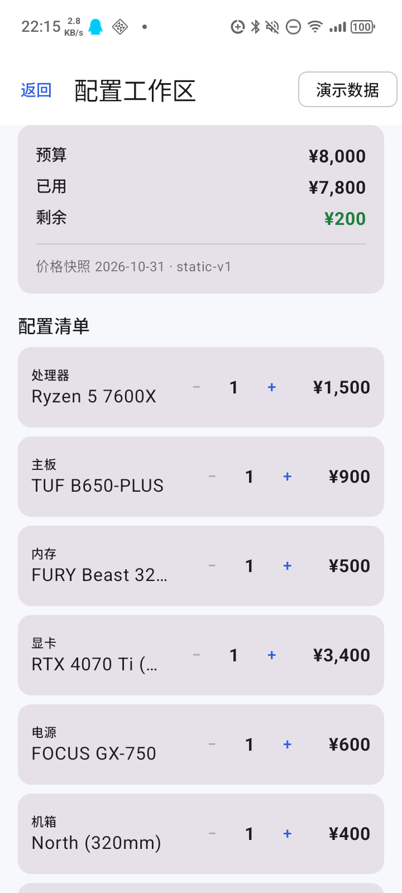
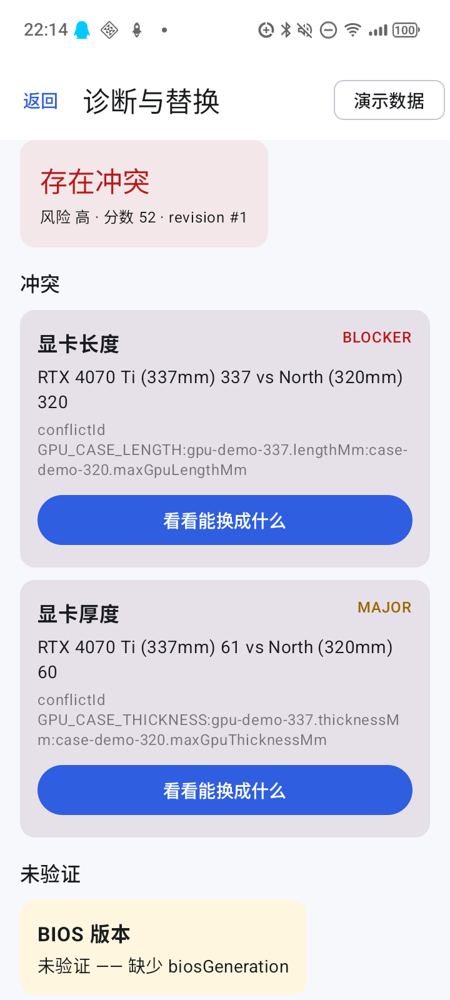
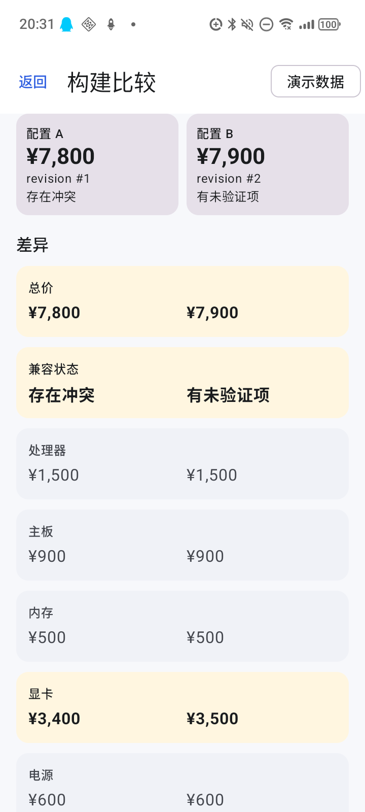
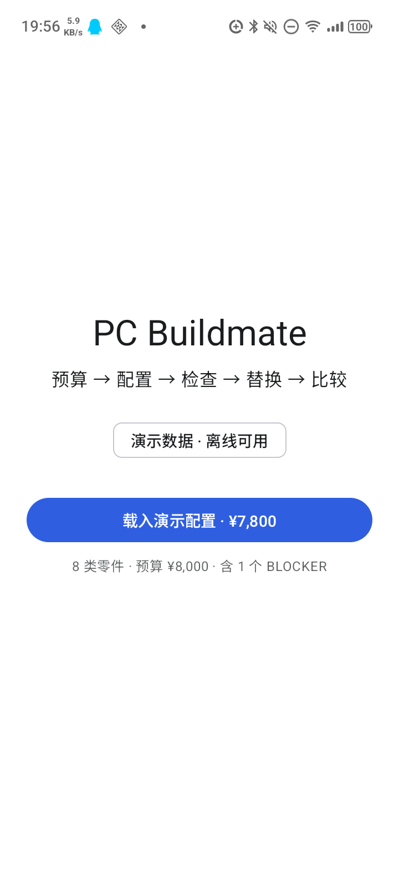

# PC Buildmate

> EE5415 小组作业 · Android 12+ · 中文界面 · **完全离线**
>
> 一个装机决策工具：输入预算和用途，得到一份**带价格、检查过、可比较**的配置单。
> 每条结论都带证据：字段有 `VERIFIED / REPORTED / EMPTY`，检查结果继承最弱证据，缺字段只能返回“未验证”。

**这不是概念稿了。** 真机上已经能跑完整链路：

```
载入 ¥7,800 配置 → 检查（1 BLOCKER + 1 MAJOR + BIOS 未验证）
→ 换 300mm 显卡（+¥100）→ 预览 ¥7,900 → 全量重检 → 应用
→ BIOS 仍然“未验证” → 保存 A/B → 并排比较
```

## 现在能跑什么

| 工作区 | 诊断 |
|---|---|
|  |  |

| 比较 | 入口 |
|---|---|
|  |  |

- 4 屏：Entry → Workspace → Diagnostics → Compare
- 8 类零件、¥7,800 起始配置、¥8,000 预算
- 15 条兼容规则、60 条 fixture、两张状态机 76 格
- 替换建议先过滤 BLOCKER，再按价格/影响/ID 排序
- 保存 A/B 后并排比较；过期诊断不显示旧结论
- Aura A1（Android 16 / arm64）真机验证通过

## 5 分钟跑起来

```bash
git clone git@github.com:pc-buildmate/pcbuildmate.git
cd pcbuildmate
```

用 Android Studio 打开，等 Gradle sync；或者命令行：

```bash
# local.properties 指向你的 SDK（Android Studio 会自动生成）
echo "sdk.dir=/path/to/Android/Sdk" > local.properties

./gradlew :app:assembleDebug
adb install -r app/build/outputs/apk/debug/app-debug.apk
```

要求：JDK 17+、Android SDK Platform 37、`minSdk 31`。CI 只跑文档 + JVM 测试；
Android 构建在本地跑，产物是 `app/build/outputs/apk/debug/app-debug.apk`。

## 团队

| GitHub | 现在 |
|---|---|
| [@MoeField](https://github.com/MoeField) | 架构 / 集成 / UI；在做 D4 |
| [@LIU132578](https://github.com/LIU132578) | 已加入；任务自由认领 |
| [@yys1yys2yys](https://github.com/yys1yys2yys) | 已加入；任务自由认领 |
| 待加入 | 随时加，直接认领 [BOARD](docs/tasks/BOARD.md) |

> **这个阶段不锁分工**：看到想做的，就在 [BOARD](docs/tasks/BOARD.md) 把 owner 改成自己，
> 开 `feat/<id>-<slug>` 分支，按 [COLLABORATION.md](COLLABORATION.md) 走 PR。
> 不要求按优先级做，也不要求每人只做一个模块；两人想做同一块就拆模块或拆 PR，别抢同一个文件。

## 模块地图

| Gradle 模块 | 负责什么 | 状态 | 先读 |
|---|---|---|---|
| `:contracts` | 类型、端口、不变量 | 冻结 | [docs/02](docs/02-contracts.md) |
| `:contracts-test` | 端口契约测试基类 | 冻结 | [docs/07](docs/07-unit-verification.md) |
| `:data` | 目录解析、seed 校验、存储 | D1 完成；Room 待做 | [D1-01](docs/tasks/D1-01.md) |
| `:domain:rules` | 15 条兼容规则 + PSU 公式 | 完成 | [D3-01](docs/tasks/D3-01.md) |
| `:domain:replacement` | 替换候选过滤/排序 | 完成 | [D5-01](docs/tasks/D5-01.md) |
| `:domain:state` | 诊断/替换状态机 | 完成 | [D2-01](docs/tasks/D2-01.md) |
| `:domain:compare` | A/B 比较 | 完成 | [D6-01](docs/tasks/D6-01.md) |
| `:domain:recommend` | 预算推荐 | **待做** | [D4-01](docs/tasks/D4-01.md) |
| `:domain:build` | revision 构造 | 暂由 `:feature` 代做 | [docs/06](docs/06-modules.md) |
| `:feature` | ViewModel / MVI 编排 | 核心完成 | [docs/06](docs/06-modules.md) |
| `:ui` | Compose 四屏 | 可用；待打磨 | [POLISH-01](docs/tasks/POLISH-01.md) |
| `:app` | Activity / 手动导航 / 装配 | 完成 | [docs/05](docs/05-module-independence.md) |
| `:testing` | Fake / Stub | 待补 | [docs/07](docs/07-unit-verification.md) |
| `:test-oracle` | 独立参考模型 | 待补 | [QA-01](docs/tasks/QA-01.md) |

> 目录价格来源见 [assets/catalogue/SOURCES.md](assets/catalogue/SOURCES.md)：31 条、2026-11-04 参考快照，不承诺实时/库存。

## 这一周做什么

按 [BOARD](docs/tasks/BOARD.md) 的顺序：

1. **D4 预算推荐**：Entry 支持预算/用途输入，生成 8 类起始配置；权重可见。
2. **DEMO 目录**：已到 31 条（8 类 ≥3）；下一步补到每类 4+，先补机箱/散热/存储。
3. **QA 矩阵**：`check-matrix` 读真实测试结果，不再只打印规格。
4. **Room 持久化**：杀进程后 A/B 还在。
5. 以上完成后：更新演示脚本、截图、签名 APK。

每个任务都有一页小文档，放在 [docs/tasks/](docs/tasks/)。
开工前只读：任务包 + 本模块卡（06）+ 相关契约（02/`contracts/`）+ 相关规则/状态机。

## 协作三条

1. **所有改动走 PR**，CI 绿了再 squash merge；不要直接推 `main`。
2. **一个任务一个模块**；不顺手改 `contracts/`、fixture 期望值、别人模块。
3. **AI 写、人验收**：PR 里贴命令输出；UI 变更贴截图；APK 变更有人真机装过。

细则见 [COLLABORATION.md](COLLABORATION.md)，AI 代理入口见 [AGENTS.md](AGENTS.md)。

## 深入阅读

| 想知道 | 看 |
|---|---|
| 产品范围、六功能、五条公理 | [docs/00](docs/00-overview.md) |
| 三态证据、术语 | [docs/01](docs/01-glossary.md) |
| 契约与不变量 | [docs/02](docs/02-contracts.md) |
| 15 条规则、冲突 ID | [docs/03](docs/03-rules.md) |
| 两张状态机 76 格 | [docs/04](docs/04-state-machines.md) |
| 模块边界 / 依赖矩阵 | [docs/05](docs/05-module-independence.md) |
| 单元验证 / 矩阵 / 变异 | [docs/07](docs/07-unit-verification.md) |
| 范围外清单 | [docs/09](docs/09-ci-and-scope.md) |
| 答辩口径 / 风险 | [docs/13](docs/13-risks.md) |
| 提案 / 讲稿 / Q&A 原文 | [materials/](materials/README.md) |
| 可点击的原型 | [site/](site/) |

## 自检

```bash
node tools/check-docs.mjs
node ci/check-boundaries.mjs
node ci/check-keywords.mjs
node tools/check-matrix.mjs

node tools/test-demo-engine.mjs
node tools/test-demo-flow.mjs
node tools/test-demo-ui.mjs

./gradlew :data:testDebugUnitTest :domain:rules:test :domain:state:test \
  :domain:replacement:test :domain:compare:test
```

## 已知边界

- 目录是 **demo 数据**，不是实时市场；价格带日期，但不承诺库存。
- 不做 FPS / 跑分 / 性能分档；不做 3D 装配；不接账号 / 云同步。
- 目前没有 Room 持久化；杀进程后保存的 A/B 会丢。
- 比较页目前只输出总价、状态、分类花费；功耗/升级余量/物理尺寸待补。
- 演示只覆盖 2 份配置；3 份需要横向滚动。

---

仓库：<https://github.com/pc-buildmate/pcbuildmate> · 文档版本见 [docs/VERSION](docs/VERSION)
