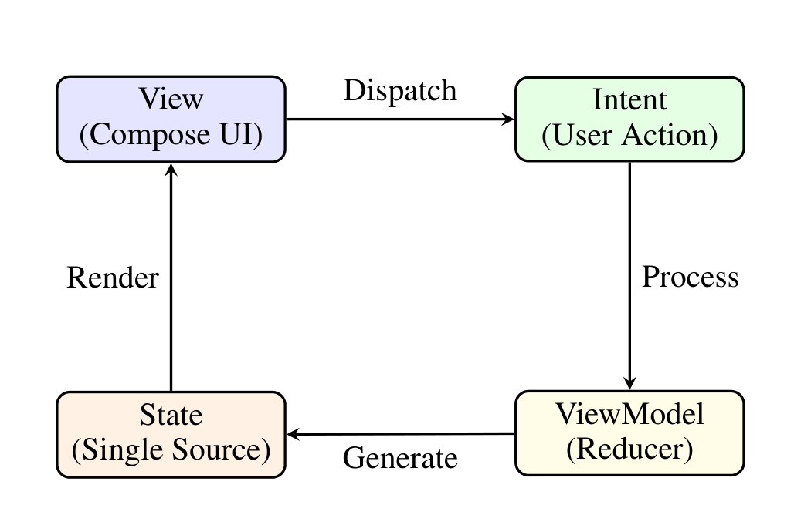
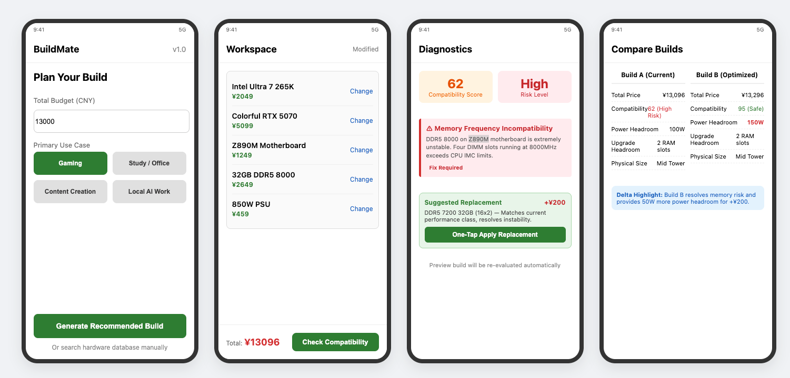

# BuildMate — An Android App for PC Build Planning

**王嘉瑞 刘喆 陈思言 阮立坤 杨壹硕 黄奕维**

Electrical and Electronic Engineering (EEE) · EE5415 Group Project Proposal

> 由 `BuildMate_EE5415_Original_Format.docx` 转换。仅作答辩口径参考，非规格；
> 与 `docs/` + `contracts/` 冲突时以后者为准。图片位于 `materials/source/media/`。

## Abstract

BuildMate is a mobile-first Android build advisor that turns a budget and a stated use case into a costed, compatibility-checked DIY PC configuration. The proposal has six parts. Problem and Motivation sets out the cost and risk of assembling a custom PC from scattered sources, and the four user groups affected. App Vision describes the product as one repeated journey: plan, customize, check, resolve, compare. Key Features specifies the six functions that carry that journey — hardware database, DIY configuration workspace, compatibility check, budget planning with recommendation, intelligent replacement suggestions, and build comparison — together with the field-level verification states behind them. Architecture and UI Approach gives an MVI unidirectional data flow across three layers and a four-stage mobile workflow. Market Position places BuildMate against PCPartPicker and BuildCores. Conclusion states what the first release will and will not attempt.

## Problem and Motivation

### Problem Statement

A first-time PC builder today must manually combine component compatibility, performance, pricing, and availability data from multiple disconnected websites, usually on a desktop, while making high-cost decisions with very little confidence.

The difficulty is structural rather than incidental.

- Building a custom PC involves many interdependent parts: CPU, motherboard, RAM, GPU, PSU, case, cooling.

- One wrong choice can cause:

  - physical incompatibility

  - boot failure

  - poor price-to-performance

  - CPU/GPU bottleneck

  - wasted money and return hassle

- Information is scattered across:

  - manufacturer spec pages

  - PC building forums like Reddit and Tom’s Hardware

  - PCPartPicker

  - YouTube reviews

  - retailer price lists

  - power supply calculators

The result: users feel overwhelmed and afraid to make a mistake.

### Who Has This Problem

The difficulty is not confined to beginners. Four groups of users meet it at different points and for different reasons:

Table 1: The four user groups, their situation, and their main pain.

| **Persona** | **Situation** | **Main Pain** |
|----|----|----|
| First-time builder | Student or gamer building a \$700–\$1200 PC | Fear of incompatible parts, too much jargon |
| Budget-conscious upgrader | Replacing GPU, RAM, or CPU | Unsure if upgrade is compatible or worth the money |
| PC enthusiast / hobbyist | Constantly comparing price-to-performance and new releases | Wants fast structured comparison and “what if” builds |
| Small PC builder / shop | Builds machines for customers | Needs reusable configurations, quick compatibility checks, shareable quotes |

The same gap therefore appears both for someone assembling a first machine and for experienced users who already know what they want.

### Why It Is Still a Problem Today

- Users often need 5–10 browser tabs open just to check compatibility and prices.

- Most compatibility tools are desktop-web-first, not mobile-friendly.

- Price and stock change constantly, but there is no convenient mobile alert system.

- Existing tools are often US-centric, weak for users in other regions.

- A mistake is expensive: you cannot easily return a CPU or motherboard after installation.

### Why Android

The choice of Android follows from where the decision is made and from what the platform provides.

#### User-context advantages

- PC building research happens everywhere: at home, in a store, at school, with friends.

- An Android app works on the go and can support offline hardware data when internet is poor.

- Smartphone features like camera and AR can enable:

  - barcode scanning of components in a store

  - visual case preview

  - quick photo notes

#### Platform advantages

- Android has the largest global smartphone market share, reaching more students, hobbyists, and users in emerging markets.

- Android development with Kotlin and Jetpack Compose allows a modern, fast, responsive UI.

- Google Play and APK distribution make it easy to share and test.

- Push notifications can deliver:

  - price-drop alerts

  - compatibility warnings

  - new CPU/GPU release news

#### Why not just a mobile website?

A native Android app gives:

- better offline access

- smoother navigation

- saved builds on device

- camera and AR integration

- persistent preferences and history

### Motivation

Our motivation is to lower the entry barrier for custom PC building by turning scattered hardware data and confusing compatibility rules into one mobile-first, confidence-building tool.

#### Other Motivations

- Existing tools are either powerful but desktop-web-first, or fragmented and inconsistent.

- No mainstream Android app currently combines a hardware database, DIY configuration, compatibility checking, budget planning with recommendation, intelligent replacement suggestions and build comparison in one place.

- We want to help users avoid costly mistakes and discover better configurations.

## App Vision

BuildMate is envisioned as a mobile-first Android application that guides users from an initial budget or component idea to a checked and comparable DIY PC configuration. Its purpose is not merely to display a list of computer parts, but to make hardware decisions understandable and manageable. In the intended experience, users can see what they have selected, identify potential incompatibilities, understand the reasons behind them, and evaluate alternative choices before spending money.

The application offers two entry points. First-time builders can enter a budget and a primary use case, such as gaming, studying, or content creation, to obtain an editable starting configuration. Users who already have specific preferences can instead select components directly from a searchable hardware database. Both routes lead to the same configuration workspace, where components may be added, removed, or replaced, and the estimated total cost is updated using available reference-price data. The recommendation remains a starting point rather than a restriction on user choice.

After selecting components, users can request a compatibility check. BuildMate will examine supported hardware relationships, including processor and motherboard socket matching, memory-generation support, and physical clearances when sufficient specifications are available. The result will explain detected conflicts instead of presenting only a pass-or-fail indicator. Where information is incomplete, the app will explicitly flag an unverified condition rather than assume compatibility. For a detected conflict, users will be offered compatible replacement candidates with their estimated price differences, allowing a change to be reviewed before it is applied. Whenever a component is changed, users can run the check again and compare their revised configuration with other saved builds.

This repeated journey—plan, customize, check, resolve, and compare—connects the six planned functions: a hardware database, DIY configuration, compatibility checking, budget-based recommendation, intelligent replacement suggestions, and build comparison. The initial release will prioritize a clear interface and a reliable end-to-end workflow over speculative features such as exact performance predictions or detailed three-dimensional assembly. In the longer term, the team intends to maintain BuildMate as an open-source project, expanding its verified component coverage and improving its recommendations as resources permit. Potential revenue from transparently disclosed shopping referrals could be explored later without determining the neutrality of the initial recommendations. Ultimately, our vision is to help users make informed, budget-conscious PC-building decisions with greater confidence.

## Key Features

BuildMate is organised around six features that operate on one shared component model: a hardware database, a DIY configuration workspace, a compatibility check, budget planning with configuration recommendation, intelligent replacement suggestions, and build comparison. Every feature reads and writes the same structured build revision, so a change made in one screen is visible in the others, and the same rule set decides what a recommendation may propose and what a substitution may offer. The features are also ordered by dependency: the database supplies structured specifications, the rule table consumes them, and the remaining features turn an intention into a costed, checked and comparable build.

Table 2: The six features, the question each one answers, and the mechanism behind it.

| **Feature** | **Question it answers** | **Mechanism** |
|----|----|----|
| Hardware database | What is this part, what does it cost, and will it fit? | Structured component records with verification states and dated reference prices |
| DIY configuration workspace | What am I building, and what does it cost so far? | Editable build revisions with live totals |
| Compatibility check | Will these parts work together? | Deterministic rules over socket, memory generation, clearance and power |
| Budget planning and recommendation | What should I buy with this budget for this use? | Use-case budget bands that produce a complete editable build |
| Intelligent replacement suggestions | What do I change when a part does not fit? | Ranked substitutions with price and specification deltas |
| Build comparison | Which of these builds should I buy? | Side-by-side deltas in price, compatibility, headroom and size |

### Hardware Database

The hardware database is a structured catalogue, and the rest of the app depends on that choice. A record gives a component its category, manufacturer, model and part number, and stores the attributes that later checks read: processor socket and supported chipsets, memory generation and module type, rated and peak power draw, graphics card length, thickness and slot width, cooler height and mounting kit, case form factor and clearance, and the storage and expansion interfaces a board or case provides. Prices are held as dated reference values in CNY with their source, so a user can tell how old a price is. Compatibility logic reads field values rather than product names, so two listings of the same part cannot produce different verdicts.

Every field that a compatibility rule depends on also carries a verification state. A value taken from a manufacturer specification sheet is marked verified, a value taken from a retailer listing is marked reported, and a field nobody has confirmed is left empty. The interface shows the state for each field on the specification screen and summarises it for the record, and the compatibility check inherits it, so a rule that depends on an empty field returns unverified rather than a pass.

### DIY Configuration Workspace

Two entry points lead to the same workspace. A user who starts from a budget and a use case receives a complete starting build, and a user who already has a part in mind starts from an empty list and adds components from the database. Inside the workspace, components can be added, removed, replaced or duplicated, quantities can be set, and the running total, the remaining budget and the spend per category are recomputed on every change. The state of the compatibility check is shown beside the build rather than on a separate screen, so an edit and its consequences are seen together.

Each change produces a new revision. Revisions are kept so a user can undo a decision, return to an earlier state, or hold two variants for a later comparison. No category is locked and a recommended build can be edited freely; the app marks such a build as user-modified and keeps checking it in the same way.

### Compatibility Check

The compatibility check evaluates the selected components against one another and reports a result for each rule. The first release covers the relationships that decide whether a build can be assembled and run:

- Processor and motherboard: socket, chipset and BIOS generation support.

- Memory and motherboard: DDR generation, slot count, module capacity and the board's total capacity limit.

- Graphics card and case: card length and thickness against the supported clearance and slot count.

- Power supply and build: connector set and continuous output against an estimated load with headroom.

- Cooler and case: cooler height and socket mounting kit against the available clearance.

- Motherboard and case: form factor, plus the storage and expansion interfaces that the case and the board provide.

A rule compares named values and returns one of three outcomes: passed, conflict or unverified. A conflict names the two values that produced it, for example a 337 mm card against a 320 mm case limit, and an unverified result names the missing field. A rule whose inputs are empty never reports a pass, so the app cannot claim that a combination works on the strength of a field nobody has checked. Each result also carries the weakest verification state among the values behind it, so a pass that rests on retailer data is presented as such. Conflicts are ranked by severity, so accepting a minor observation does not look like confirming the whole build.

The rules live in a table of constraints that the engine evaluates. A new hardware generation is added by extending data and test cases rather than by rewriting screens, and every rule keeps example builds in a regression set, including cases where a required field is missing and the expected outcome is unverified.

### Budget Planning and Configuration Recommendation

Budget planning takes a total budget, a primary use case and optional preferences such as case size, noise level or room to upgrade later, and returns a complete, editable build. The recommendation divides the budget across component categories using weighted bands that change with the use case: a gaming build gives the largest share to the graphics card, a study or office build protects the processor, memory and storage, and a content-creation build weights processor cores, memory capacity and storage speed. The bands are visible, so a user can see why a part at that price level was chosen and can adjust the weighting.

Two constraints keep the recommendation honest. A proposed build must pass every check the app can evaluate, and it must stay inside the budget. When the stated use case cannot be met at the stated budget, the app says so, offers the closest configuration that is internally consistent, names the shortfall and reports any preference it had to relax. The user pays for a compromise knowingly or raises the budget.

### Intelligent Replacement Suggestions

This feature answers the question that follows a failed check. When a rule reports a conflict, the app searches the catalogue for parts that remove the conflict while respecting every other constraint in the build, ranks the candidates that survive, and presents each one with its price difference, its specification difference and any effect on other rules. A user whose graphics card is too long for the case sees the shorter cards in the same performance class with their price deltas, and a card that would also need a larger power supply is labelled as such instead of being hidden.

Ranking combines the price difference, the distance from the user's stated preferences and the effect on remaining headroom. Different strategies are supported, for example replacing the cheapest part that resolves the conflict, or keeping the processor and rebuilding around it. Applying a suggestion previews the resulting build and re-runs the complete check before the change is kept, so a resolution cannot introduce a new conflict. When no candidate resolves the conflict, the app reports the constraint that blocks it and the smallest change that would unblock it. Explaining what stands in the way, as well as what to buy, is what existing tools leave out.

### Build Comparison

Comparison places two or three builds side by side. It reports the total price, the compatibility status and any outstanding conflict, the spend by category, an indicative performance band for the stated use case, power headroom, upgrade headroom such as free memory slots and unused storage bays, and the physical size of the build. Differences are highlighted, so the user reads what changes between the options instead of comparing two lists of part names. On a phone the comparison is presented as stacked per-build summaries with the deltas called out beside them, which keeps both builds readable within one column width. A plan card imported from another user can be compared against the current revision in the same view.

### Scope Boundaries and Delivery Priorities

The six features are bounded deliberately. Within that boundary the feature set is complete: a user can arrive with a budget or with a part, leave with a costed and checked build, repair a conflict with a ranked suggestion, and compare alternatives without leaving the app. Benchmark prediction, three-dimensional assembly previews, live retailer inventory, second-hand pricing and version-to-version catalogue comparison are recorded as later work. Expanding catalogue coverage is a data task with an explicit backlog rather than a change to the rules, and the catalogue version stored with a build is a trace of the data behind a check rather than a feature to compare across versions.

## Architecture and UI Approach

### Architecture: MVI-Based Unidirectional Data Flow

To support the complex, interdependent decision loop described in the App Vision (plan, customize, check, resolve, and compare), we adopt an MVI (Model-View-Intent) architecture with a unidirectional data flow, implemented in Kotlin with Jetpack Compose.

The rationale for MVI over traditional MVP or MVVM is driven by state consistency. In a DIY build, swapping a single component (e.g., a GPU) simultaneously affects the total price, power headroom, physical clearance, and compatibility status. Traditional MVVM with multiple LiveData objects can easily lead to fragmented states (e.g., the GPU updates but the total price does not). MVI solves this by maintaining a single immutable BuildUiState.

The data flow operates as follows: the UI dispatches an Intent (e.g., ReplaceComponent), the ViewModel processes it through a Reducer and business logic (calling the compatibility rule engine and repository), generates a new BuildUiState, and exposes it via StateFlow.

The UI is a pure function of the state, rendering the latest configuration, diagnostic results, and replacement suggestions seamlessly.

Figure 1: The MVI Unidirectional Data Flow Architecture

To address the Key Features requirement of a reliable end-to-end workflow, our architecture consists of three layers:

- UI Layer: Jetpack Compose, observing StateFlow and dispatching user intents. It includes the Configuration Workspace and the Diagnostic Dashboard.

- Domain Layer: Pure Kotlin modules containing the deterministic Compatibility Rule Engine and the Replacement Ranking Algorithm. This layer evaluates field values (socket, clearance, power) and returns Passed, Conflict, or Unverified, adhering strictly to the database verification states.

- Data Layer: A Repository backed by Room, storing the structured hardware database with dated reference prices and field-level verification states (Verified, Reported, Empty).

Pragmatic Implementation Strategy: To ensure a deliverable scope, the first release strictly enforces unidirectional data flow in the core Configuration and Diagnostic modules. For secondary screens (e.g., settings, about), a lightweight MVVM approach is retained. This is a deliberate engineering trade-off to avoid over-engineering boilerplate while preserving state integrity where it matters most.

### UI Approach: Mobile-First and Actionable Diagnostics

The UI is designed for one-handed mobile use, prioritizing clarity and actionable outcomes over mere data display. The interface follows a linear, four-stage workflow:

1.  Entry & Budget Planner: Users input a budget and select a primary use case (gaming, study, content creation) or search for specific parts.

2.  Configuration Workspace: A vertically scrolling list of selected components (CPU, GPU, Motherboard, etc.) with live prices and a persistent bottom bar showing the total cost and a prominent “Check Compatibility” button.

3.  Diagnostic & Resolution Dashboard (Core Differentiator): Instead of a simple pass/fail indicator, this screen presents a compatibility score, risk level, and detailed conflict explanations (e.g., “GPU length exceeds case clearance by 17mm”). Crucially, it lists ranked replacement candidates with their price deltas and performance impacts, accompanied by a “One-Tap Apply” button.

4.  Build Comparison: Two or three saved builds are stacked side-by-side, highlighting differences in total price, power headroom, and upgrade potential.

Figure 2: BuildMate UI wireframes for the four-stage workflow: (1) Entry & Budget Planner, (2) Configuration Workspace, (3) Diagnostic & Resolution Dashboard, and (4) Build Comparison.

Unlike existing tools that stop at diagnosis (e.g., “AI Help” in current market apps), our UI bridges the gap to prescription. The MVI state snapshot makes it trivial to preview the entire build after a replacement is applied, ensuring that resolving one conflict does not silently introduce another.

### Work Allocation

The project workload is distributed to ensure every member has a significant and purposeful contribution:

- 黄奕维 (Architecture & UI Lead): Defines the MVI data flow, designs the four-stage UI prototype, and coordinates module integration.

- 刘喆 (Data Layer): Implements the Room database, hardware records with verification states, and repository interfaces.

- 王嘉瑞 (Domain Layer): Implements the compatibility rule engine and the intelligent replacement ranking algorithm.

- 阮立坤 (UI Layer): Implements Jetpack Compose screens, navigation, and binds the UI to the ViewModel state.

- 陈思言 (Information Gathering): Collects component specifications, verification states, and dated reference prices from manufacturer sheets, retailer listings, and community build lists.

- 杨壹硕 (Integration Testing and Presentation): Coordinates integration testing, maintains the regression test set, and consolidates presentation materials.

## Market Position

We position BuildMate as the mobile-first build advisor for first-time and budget-constrained DIY builders. The product does not try to own the largest parts catalogue; it owns the shortest path from “I have a budget and something I need this machine to do — gaming, study and office work, video editing, or local AI work” to “here is a build that works, here is what it costs, and here is what to change if something does not fit.” BuildMate turns a budget and a use case into a build that is fitted to the budget, validated against compatibility rules, and comparable across alternatives. When a check fails, it does not stop at the error: it returns ranked substitution candidates together with their price differences. Existing products each hold one slice of this loop; none of them holds the loop on a phone.

### What Exists Today, and What It Leaves Open

Two products define the space. PCPartPicker holds the deepest parts catalogue and a compatibility filter, but it is a desktop-web tool that ends at selection and price. BuildCores goes further on presentation, with 3D assembly previews, live compatibility validation and price history, yet it is web-first and unlocalised, and it too leaves the user to work out the replacement when a part fails a check. Both treat a build as a list of parts to be assembled and stop before the questions the buyer actually has: will this combination work, what should I change if it does not, and which of my options is the better buy?

### Six Differentiators

- D1 — Mobile-first by design. The decision is made on a phone while the tools live on the desktop. BuildMate is built for one-handed use and for the in-store moment, and a plan can be shared as a single card and reopened anywhere.

- D2 — One end-to-end decision loop. Budget planning, recommendation, compatibility validation, conflict resolution and plan comparison happen inside one flow. Competitors cover one or two of these steps and hand back the rest.

- D3 — Actionable substitution advice. No product in this market answers the question that follows a failed check. When a check breaks — a graphics card longer than the case clearance, for instance, or a power supply below the projected draw — we return a ranked list of replacements with their price differences and the trade-off in specification, applicable in one tap. This is our sharpest differentiator and the feature we intend to demonstrate.

- D4 — Side-by-side comparison. Two or three candidate builds are placed side by side on price, compatibility and upgrade headroom, so a choice rests on evidence instead of on whichever list a stranger posted online.

- D5 — Neutral recommendations. Recommendation quality is decoupled from inventory, and prices appear as multi-source reference information. Retailer-hosted configurators are structurally unable to make that commitment.

- D6 — Fit to the local market. A Chinese-language parts database with domestic channels, prices and community build lists — the segment that neither of the two leading part pickers currently serves.

### Value

For the target user the value is decision cost and avoided mistakes: hours of cross-site reading and waiting for replies become two or three credible plans in minutes, with compatibility, dimension and power errors caught before money is spent. The demand is also already validated rather than hypothetical: interactive build-planning platforms report audiences in the millions and tens of millions of published builds, so the market does not need to be educated, and what remains unserved is the mobile-native, substitution-oriented and locally priced part of it. Commercially, a neutral recommendation engine extends naturally to price-comparison referral, brand and system-integrator referral, or a configuration API for businesses.

## Conclusion

Custom PC building is a high-cost, high-risk decision made on fragmented information. A first-time builder must reconcile sockets, memory generations, physical clearances, power budgets and prices across manufacturer specification pages, forums, retailer listings and video reviews, knowing that one wrong choice can mean a system that will not boot, a CPU or GPU that bottlenecks the other, or a component that cannot be returned once it has been installed. The problem is not niche: it is shared by the student assembling a first machine, the owner replacing a single graphics card, the enthusiast running “what if” comparisons, and the small shop that needs reusable configurations. It persists because the tools that already exist are desktop-web-first and stop at selection and price.

BuildMate answers this with six features — a hardware database, a DIY configuration workspace, a compatibility check, budget planning with configuration recommendation, intelligent replacement suggestions, and build comparison — organised not as separate utilities but as one repeated journey: plan, customize, check, resolve, compare. One idea holds them together: every claim the app makes about a build carries its evidence. Each specification field records whether its value came from a manufacturer sheet, from a retailer listing, or from nobody; a check inherits the weakest state among the values behind a result, and a rule whose inputs are empty returns unverified rather than a pass, so the app cannot call a combination compatible on the strength of a field nobody has verified. A conflict is therefore never a bare failure: it names the two values that collided, such as a 337 mm card against a 320 mm case limit. A resolution is never a guess either: ranked replacement candidates carry their price and specification deltas, and applying one previews the resulting build and re-runs the full check before the change is kept, so a fix cannot introduce a new conflict. When no candidate works, the app reports the constraint that blocks the user and the smallest change that would unblock it. Existing tools stop at the error; explaining what stands in the way, as well as what to buy, is the sharpest edge of this project and the behaviour we intend to demonstrate.

BuildMate uses an MVI (Model-View-Intent) architecture with a unidirectional data flow in Kotlin and Jetpack Compose, chosen over MVP or MVVM for state consistency: replacing one component changes price, power headroom, clearance and compatibility at the same instant, and a single immutable BuildUiState cannot let the graphics card update while the total does not. The compatibility rule engine and the replacement ranking algorithm live in a pure-Kotlin domain layer that reads field values, returns passed, conflict or unverified, and respects the verification states recorded in the data layer, so the rules can be unit-tested before they are trusted with a user’s money. The interface follows the four stages the wireframes set out — entry and budget planner, configuration workspace, diagnostic and resolution dashboard, and build comparison — and it is designed around the situation the problem statement describes: a decision made one-handed, on a phone, standing in front of a parts shelf.

Existing tools each hold one part of this loop; BuildMate holds the loop itself, on the device where the decision is actually made. The recommendations remain neutral and the user’s choice always remains their own.

The next step is to turn this design into working code. The scope is deliberately bounded: the six features are complete as a set, while benchmark prediction, three-dimensional assembly previews, live retailer inventory, second-hand pricing and catalogue version comparison are recorded as later work. During the project the priority is a clear interface and a reliable end-to-end workflow rather than speculative accuracy. Because the compatibility rules live in a data table rather than in the screens, a new hardware generation is added by extending data and test cases, and every rule keeps example builds in a regression set — including the cases where a required field is missing and the correct answer is unverified. Success will be measured not by the size of the parts database, but by whether a first-time builder can move from “I have a budget” to “here is a build that works, here is what it costs, and here is what it will run” — and understand every step of the way.
